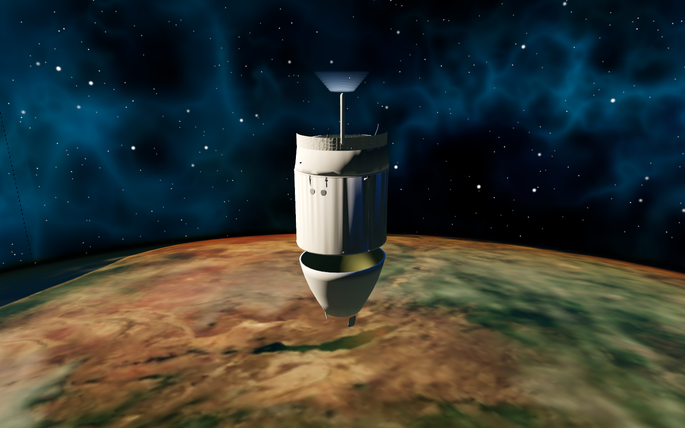
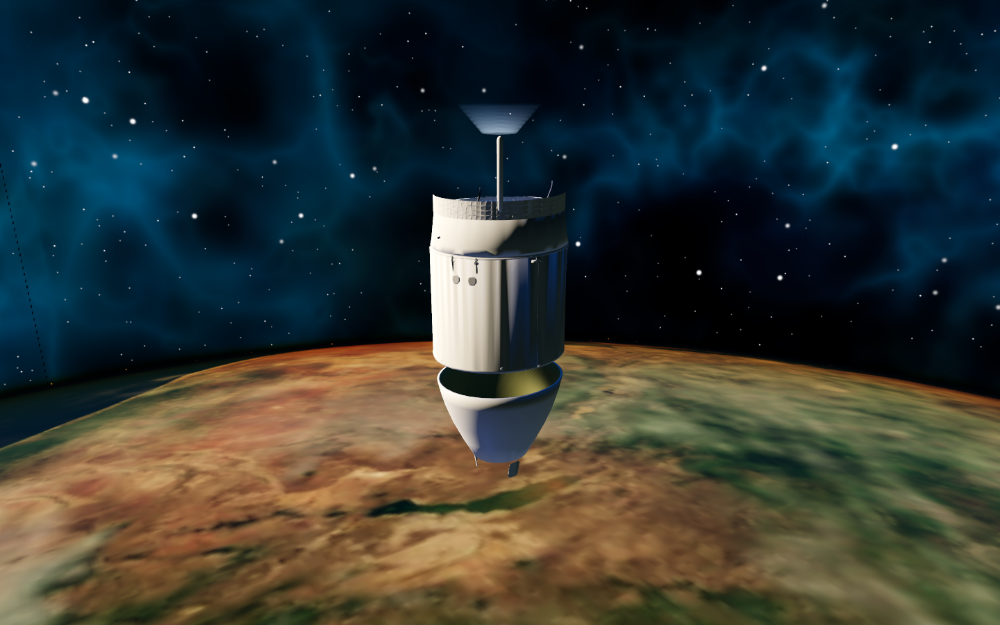
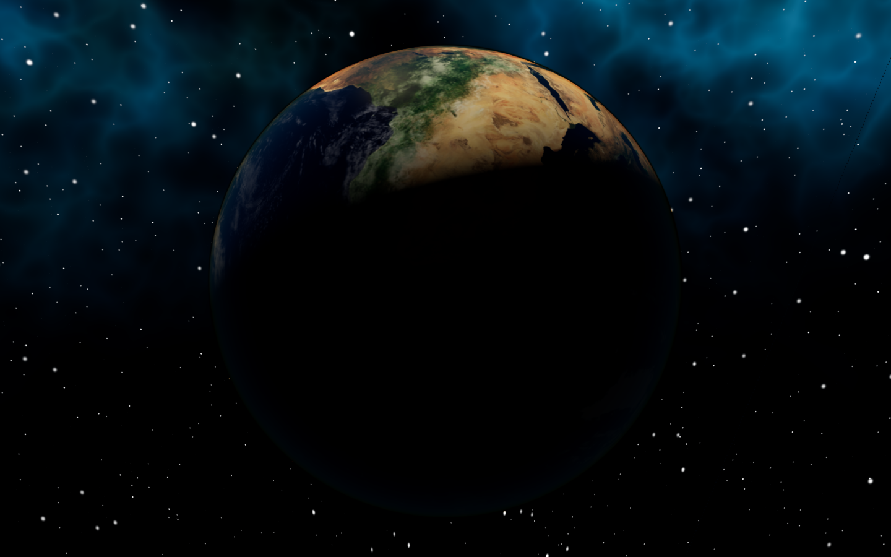
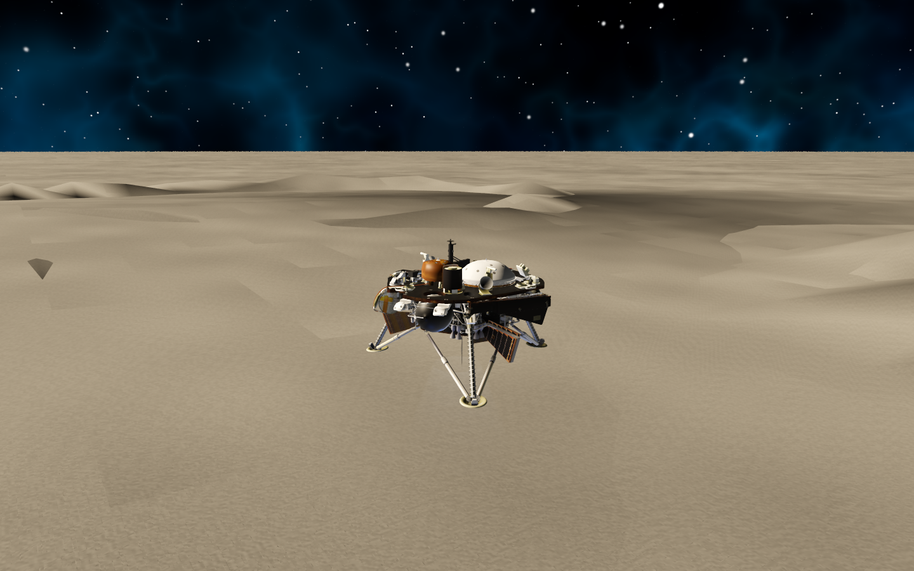
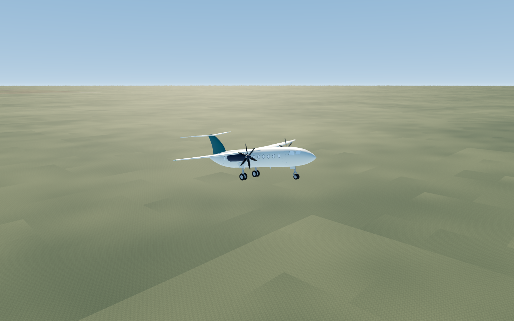
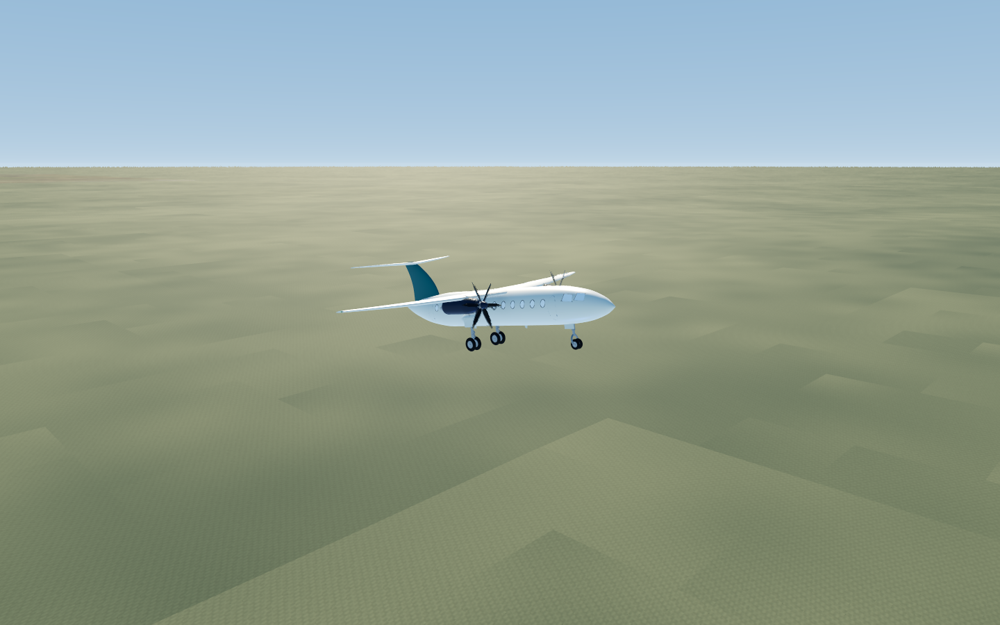
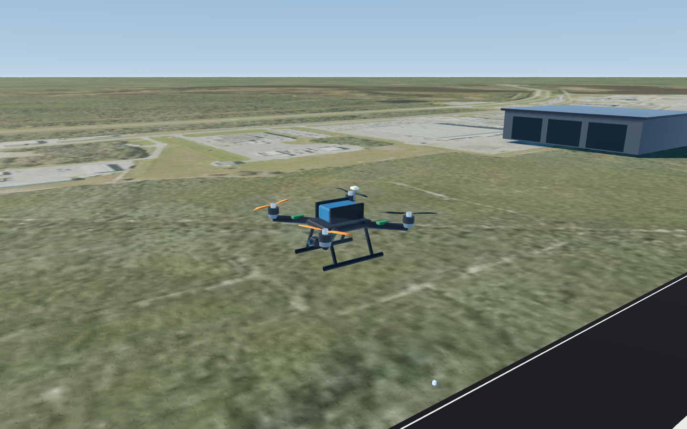

# Confronto grafico 2.5.0

Implementato: normal map originale procedurale per micropannelli, rivetti e
spazzolatura; materiali originali e trasparenze preservati; clearcoat misurato
sui metalli, filtro anisotropico/mipmap; ombre a quattro cascades con blending;
luce riflessa blu disattivabile; Ultra Cinema scala1.5; FPS e millisecondi HUD.
Basso salta i nuovi dettagli. I GLB/LOD e lo streaming chunk preesistenti restano.

## Misura reale

Godot4.7.2, NVIDIA RTX5080 Laptop,1440×900, VSync off. Cinque stati Python e camere
riutilizzati: veicolo orbitale, terminatore terrestre, discesa lunare, aereo, drone.
Almeno2s di misura e150 frame dopo warmup. Solo renderer con fisica ferma; attività
CPU di verifica erano presenti durante alcune misure. Questi dati non garantiscono
prestazioni su GPU media né il costo del gioco completo. Il budget misurato per
preset è il peggior p95 tra queste viste, non un limite imposto agli FPS.

|Preset|FPS min–max tra viste|Peggior p95 ms|
|---|---:|---:|
|low|961.4–1389.0|1.28|
|balanced|280.4–310.9|4.41|
|high|243.9–292.5|4.81|
|ultra|166.6–249.0|8.38|
|cinema|154.6–196.4|7.40|

Nebulosa/stelle: sorgente protetta invariata e PNG della vista isolata identico
prima/dopo per i quattro preset esistenti. Camere identiche nei parametri; confronto
posizioni tollera l'errore float relativo1e-6 per distanze planetarie.

## Catture prima / dopo

### orbit

### earth-terminator

### moon-descent

### aircraft

### drone

## Limiti della consegna

Il salto AAA completo richiesto non è raggiunto. Pianeti, scattering Rayleigh/Mie,
nuvole compositate, glint oceanico, terreno locale, flipbook/particelle e reentry
preesistenti sono conservati. Non aggiunti: nuvole volumetriche/ombre dedicate,
luci urbane misurate, heightmap/DEM lunare, motion blur, aberrazione, grain,
nuove decal geometriche e RCS fisico a propellente. Non si dichiarano nuove
meccaniche o dettaglio planetario che i dati offline non supportano.
Il test visuale è riproducibile con tools/verify_upgrade_graphics.py; non è una
certificazione hardware. Asset originali MIT nei crediti, nessun download runtime.
